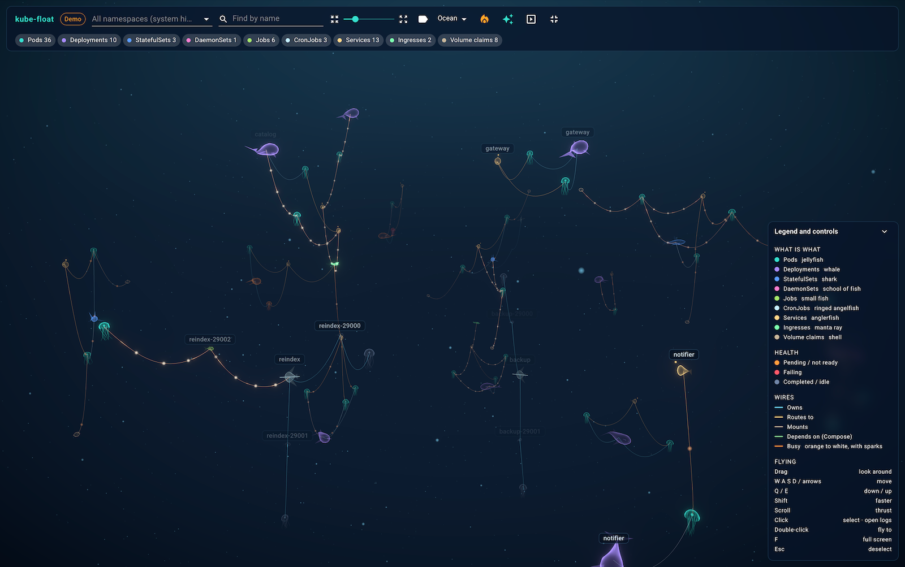
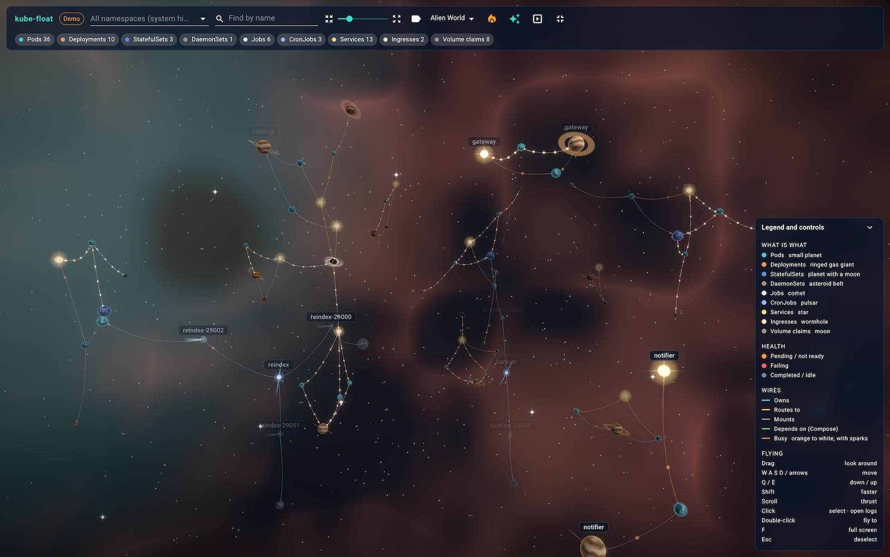

# kube-float features

Everything kube-float does, and how each part behaves. For installing and
starting it, see the [README](../README.md).

- [The scene](#the-scene)
- [Themes](#themes)
- [Creatures](#creatures)
- [Health colours](#health-colours)
- [Wires](#wires)
- [Activity](#activity)
- [Flying](#flying)
- [Selecting and details](#selecting-and-details)
- [Pod logs](#pod-logs)
- [Toolbar](#toolbar)
- [Presentation mode](#presentation-mode)
- [Full screen](#full-screen)
- [Graphics quality](#graphics-quality)
- [Live data](#live-data)
- [Docker Desktop](#docker-desktop)
- [Demo mode](#demo-mode)
- [Safety](#safety)
- [Settings](#settings)
- [Limits](#limits)

## The scene

The cluster is laid out in three dimensions by a force simulation: things
that are connected pull together, everything else pushes apart.

- **Namespaces form shoals.** Each namespace is pulled towards its own point
  on a circle, so namespaces sit apart from each other.
- **Depth has meaning.** Ingresses float highest, then Services and CronJobs,
  then workloads, then pods, with volume claims at the bottom. Traffic
  therefore reads from top to bottom.
- **Positions are kept.** When the cluster changes, existing creatures stay
  where they are and new ones drift into place.

Every creature bobs slowly, particles drift past to give a sense of speed,
and distant things fade into the background.

## Themes

The theme menu in the toolbar switches the whole look. The choice is
remembered in this browser. Everything else (layout, wires, filters, logs)
works the same in every theme.

- **Ocean.** A dark sea with plankton. Pods are jellyfish; the rest are fish
  and other sea animals, described below.
- **Alien World.** A galaxy coloured after the Hubble image of the Orion
  Nebula: a turquoise heart, red and rose gas filaments, brown dust lanes and
  blue-white stars with four-pointed spikes. Planets are lit from one side by
  a far-off sun. Wires barely sag, since nothing pulls them down.

| Kind | Ocean | Alien World |
| --- | --- | --- |
| Pod | Jellyfish | Small planet with a thin atmosphere |
| Deployment | Whale | Tan, banded gas giant with rings |
| StatefulSet | Shark | Blue planet with a moon in orbit |
| DaemonSet | School of fish | Ring of tumbling asteroids |
| Job | Small fish | Comet with a tail, on a tight orbit |
| CronJob | Angelfish in a ring | Pulsar sweeping two beams |
| Service | Anglerfish | Star with diffraction spikes |
| Ingress | Manta ray | Wormhole: a black core in a swirling disk |
| PersistentVolumeClaim | Shell | Grey moon |

In Alien World the kinds use colours closer to real bodies (tan, ice blue,
grey rock) rather than the Ocean's colours; the legend and the kind chips
follow the theme.

## Creatures

These are the Ocean's creatures.

| Kind | Creature | How to recognise it |
| --- | --- | --- |
| Pod | Jellyfish | Small, teal, pulsing bell with tentacles |
| Deployment | Whale | Violet, the largest animal, slow up-and-down tail |
| StatefulSet | Shark | Blue, tall back fin, sweeping tail |
| DaemonSet | School of fish | Seven small pink fish circling together |
| Job | Small fish | Green, quick tail, swims a tight circle |
| CronJob | Angelfish | Pale blue, tall body, inside a tumbling ring |
| Service | Anglerfish | Gold, round, with a glowing lure |
| Ingress | Manta ray | Mint, flat, flapping wings and a long tail |
| PersistentVolumeClaim | Shell | Sand-coloured, faceted, still |

Jellyfish and shells drift in place. Fish swim slow circles around their
spot, and their wires follow them.

ReplicaSets are not drawn. A pod created through a ReplicaSet is wired
straight to the Deployment that owns it.

Nodes, ConfigMaps, Secrets and other kinds are not shown.

## Health colours

A healthy creature has the colour of its kind. Otherwise:

| Colour | Meaning |
| --- | --- |
| Orange | Pending or not ready |
| Red | Failing |
| Grey-blue, half transparent | Completed, suspended or scaled to zero |

How each kind is judged:

| Kind | Healthy | Orange | Red | Grey-blue |
| --- | --- | --- | --- | --- |
| Pod | Running, every container ready | Not ready, starting, terminating | Failed, or a container is stuck in a back-off or error state such as `CrashLoopBackOff` or `ImagePullBackOff` | Completed |
| Deployment, StatefulSet, DaemonSet | All wanted replicas ready | Fewer ready than wanted | | Scaled to zero |
| Job | Running | Waiting to start | Failed | Completed |
| CronJob | Scheduled | | | Suspended |
| PersistentVolumeClaim | Bound | Any other phase | | |

Services and Ingresses are always drawn in their own colour.

## Wires

Connections are slack wires that sag and sway. None of them are straight.

| Colour | Meaning | Drawn between |
| --- | --- | --- |
| Blue | Owns | Deployment, StatefulSet, DaemonSet or Job and its pods; CronJob and the Jobs it started |
| Gold | Routes to | Service and the pods its selector matches in the same namespace; Ingress and its backend Services |
| Sand | Mounts | Pod and the volume claims it mounts |

Selecting a creature brightens its wires and dims all the others.

A Service with no selector has no wires.

## Activity

With the flame button on (the default), wires and creatures heat up when
pods get busy. kube-float cannot see network traffic, so it uses log output
as a stand-in: it keeps reading every running pod and container, each time
counting the log lines written since that pod's previous reading, so no
activity falls between readings. A pass over the cluster starts every 5
seconds, or straight after the last one on a cluster large enough to take
longer.

- Each pod learns its usual rate. A burst above it, such as a run of
  requests to a service that logs each one, makes it glow strongly; steady
  background logging only warms it a little.
- A Deployment, Service, Ingress or Compose service takes the total of the
  pods behind it.
- A wire takes the heat of what it leads into; a mount takes the heat of the
  pod mounting it.
- Warm wires turn orange, the hottest white, and carry pulses and sparks:
  bright dots that travel from source to target, more and faster the hotter
  the wire. Busy creatures glow brighter.

The glow shows up within a few seconds of the activity; on a cluster with
many pods, a pass takes longer, so allow up to about 15 seconds. A service
that does not log its requests will not light up, however busy it is.

Measuring reads a few seconds of every pod's log on each pass, a little
background work for the cluster, Docker and the browser. Turn the flame
button off to stop it. In the demo the activity is made up.

## Flying

| Input | Action |
| --- | --- |
| Drag | Look around |
| `W` `A` `S` `D` or arrow keys | Forwards, left, backwards, right |
| `E` or `Space` | Up |
| `Q` | Down |
| `Shift` | Three times faster |
| Scroll | Thrust forwards or backwards |
| Double-click a creature | Fly to it |

- Movement has momentum: you coast to a stop after letting go.
- You start outside the cluster, looking in.
- Flying to a creature stops in front of it, further back for larger ones,
  and follows it as it swims. Any key, drag or scroll cancels the flight.
- After 25 seconds without input the camera circles the cluster slowly.
  Any input stops it.
- Movement keys are ignored while you type in the search or namespace fields.

## Selecting and details

Pointing at a creature shows its name, kind, namespace and status. Clicking
selects it, makes it glow and opens a details card at the bottom left.

The card shows:

| Row | Shown for |
| --- | --- |
| Namespace, status, age, number of connections | Everything |
| Containers, restart count, node, pod IP | Pods |
| Schedule | CronJobs |
| Ports, cluster IP | Services |
| Hostnames | Ingresses |
| Requested size | Volume claims |

The card has a **Fly to** button and, for anything with pods behind it, a
**Logs** button.

Click empty water or press `Esc` to deselect. Ending a drag does not count as
a click, so looking around never changes the selection.

## Pod logs

Clicking a pod opens its log in a floating window.

Clicking something that runs pods does the same for its pods: a Deployment,
StatefulSet, DaemonSet, Job or CronJob. When it has more than one pod, the
window has a pod picker, with healthy pods listed first. Services and
Ingresses do not open logs on a click, but their details card has a **Logs**
button for the pods they route to.

- **Move** it by dragging its header; **resize** it from the bottom-right
  corner. Clicking a window brings it to the front.
- **Pod picker**, shown when the window covers more than one pod.
- **Container picker**, shown when the pod has more than one container.
- **Tail length**: the last 100, 500 or 2000 lines.
- **Follow** (on by default): new lines stream in and the window scrolls with
  them. Turn it off to read a fixed snapshot.
- **Wrap** long lines, off by default.
- **Fly to** the pod the log belongs to.

Up to four log windows can be open; opening a fifth closes the oldest. A
window keeps the most recent 3000 lines.

Changing the container, the tail length or follow reloads the log.

If the log cannot be read, for example because the pod has not started, the
window shows the cluster's error message.

## Toolbar

- **Status chip.** *Live* with the sources being read (Kubernetes, Docker or
  both), *Connecting…* at start-up, *Demo* when showing the demo cluster.
  Hovering it says why a source is missing. If the demo is showing because
  nothing was reachable, clicking the chip tries the live sources again.
- **Namespaces.** Pick one or more to show only those. With nothing picked,
  every namespace is shown except those starting with `kube-`; pick those by
  name to see them.
- **Find by name.** Fades out everything whose name does not contain the
  text, along with its label and wires, and names every match. The field
  shows how many were found. Press `Enter` to fly to a match; press it again
  for the next one. Case does not matter.
- **Spacing slider.** Pulls the whole scene closer together or spreads it
  apart, from 0.4 to 3 times the normal distance. Creatures keep their size.
- **Name labels.** Shows or hides the permanent name labels. Pods never have
  a permanent label; they are named when pointed at or selected. Labels fade
  with distance.
- **Kind chips.** One per kind, with a count for the namespaces in view.
  Click a chip to hide or show that kind and its wires.
- **Theme**, activity, graphics quality, presentation mode and full screen,
  described in their own sections.

A collapsible legend at the bottom right lists the creatures, colours, wires
and controls.

## Presentation mode

For showing a cluster to people outside your team. It:

- hides the toolbar controls and the legend, leaving the presentation and
  full-screen buttons;
- removes namespaces from labels and from the details card;
- removes node names, pod IPs, cluster IPs and Ingress hostnames from the
  details card.

Resource names and log contents are still shown. Close any log window you do
not want on screen.

## Full screen

Press `F` or use the toolbar button. Log windows, the details card and menus
all stay available in full screen. `F` or the browser's own `Esc` leaves it.

## Graphics quality

A toolbar button switches between two settings; it shows a leaf in Light
and sparkles in Full. The choice is remembered in this browser.

| | Light (default) | Full |
| --- | --- | --- |
| Frames per second | 30 | The display's own rate, often 60 or 120 |
| Resolution | Standard | Sharp on high-density (Retina) screens |
| Glow | Single half-resolution blur | Smoother multi-level blur |
| Particles and stars | Fewer | More |
| Wire smoothness | 16 segments | 40 segments |

Light is for everyday use on a laptop; it keeps the fan quiet. Full is for
presenting on a big screen, or on a machine with a stronger graphics card.

Measured in the demo cluster in Chrome, Light uses about a third less CPU
than Full, and both use well under half of what the first release did.
Your numbers will vary with the screen, the machine and the size of the
cluster.

## Live data

Kubernetes and Docker are read again every five seconds. Creatures appear,
disappear and change colour without the scene being rebuilt, and nothing
moves unless the set of resources or connections changed.

If one source fails, the other is still shown. If both fail, kube-float
switches to the demo cluster and stops polling; click the status chip to go
back to the live sources.

## Docker Desktop

Containers in Docker Desktop are shown next to the cluster, read through
Docker's own socket. Docker Compose names are used to group them:

| Docker | Shown as | Called |
| --- | --- | --- |
| Compose project | A namespace named `docker/<project>` | |
| Compose service | A Deployment's creature | Compose service |
| Container | A pod's creature | Container |
| Container outside Compose | A pod's creature in the `docker` namespace | Container |
| `depends_on` between services | A green wire | Depends on |

They count towards the Pods and Deployments chips and are filtered the same
way. Pick `docker/<project>` in the namespace menu to see only one project.

A container's health:

| State | Colour |
| --- | --- |
| Running | Healthy |
| Running, health check starting; paused; created | Orange |
| Running but unhealthy; restarting; dead; exited with an error code | Red |
| Exited with code 0 | Grey-blue |

A Compose service is healthy when all its containers run, red if any is red,
grey-blue when all have stopped cleanly, and orange otherwise.

The details card for a container shows its state, ports and image (the image
is hidden in presentation mode). Clicking a container opens its log; clicking
a Compose service opens the logs of its containers, with a picker.

kube-float reads only the container list and container logs from Docker. It
does not read container details, which include environment variables, or
Compose labels other than the project, service and `depends_on`: the others
hold paths on your computer.

## Demo mode

An invented cluster with three namespaces, containing every kind kube-float
draws, one pending pod and one crash-looping pod, and made-up log lines.

It is used when:

- you run `yarn demo`;
- the address contains `?demo`;
- no cluster can be reached.

## Safety

- **Read-only.** Only `GET` requests reach the cluster or Docker.
- **Allow-list.** For Kubernetes, only two kinds of request are forwarded:
  listing the kinds in the table above, and reading a pod's log. Everything
  else is refused, including Secrets, ConfigMaps, `exec` and port-forwarding.
- **Tighter still for Docker.** Docker's socket gives full control of the
  machine, so only the container list and container logs are forwarded.
  Container details, images, `exec`, start, stop and everything else are
  refused.
- **No stored credentials.** `kubectl proxy` uses your existing kubectl
  context. kube-float never sees a token or certificate.
- **Nothing is saved.** Cluster data and logs exist only in the browser tab.
- **Local only.** The proxy listens on `127.0.0.1`. While kube-float runs,
  other programs on the same machine can read the same data through the dev
  server, so do not expose its port to a network.

## Settings

| Variable | Effect | Default |
| --- | --- | --- |
| `KUBE_FLOAT_PROXY` | Address of the Kubernetes API proxy the dev server forwards to | `http://127.0.0.1:8717` |
| `REACT_APP_DEMO` | Set to `1` to always show the demo cluster | unset |
| `DOCKER_HOST` | A `unix://` path to the Docker socket to read | `/var/run/docker.sock`, then `~/.docker/run/docker.sock` |
| `PORT` | Port of the web app | `3000` |

The cluster shown is whichever one your current kubectl context points at.

## Limits

- Your account must be allowed to list pods across all namespaces. Any other
  kind it cannot list is shown as absent.
- There are no CPU or memory figures and no events. Activity is measured from
  log output, not from network traffic.
- Docker is read from the local socket only; remote Docker hosts over TCP are
  not supported.
- Everything is read in full every five seconds, which suits clusters of up
  to a few hundred resources.
- Flying needs a keyboard and mouse or trackpad; there are no touch controls
  for movement.
- A browser with WebGL 2 is required.
